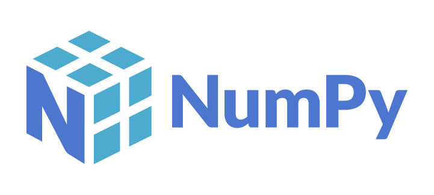
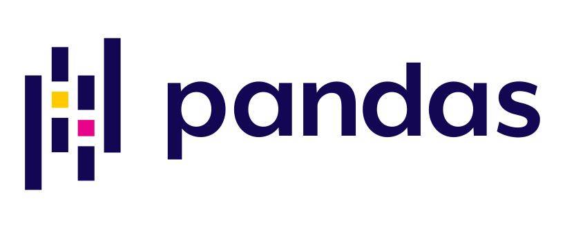
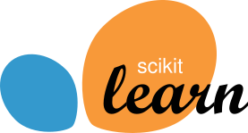
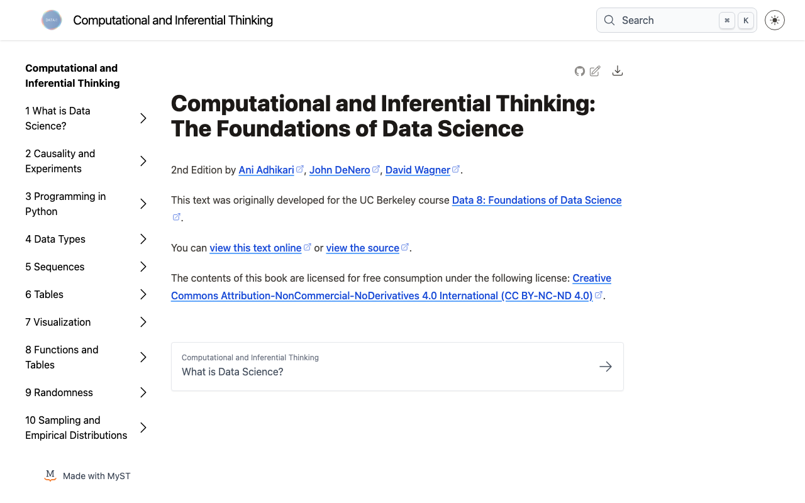
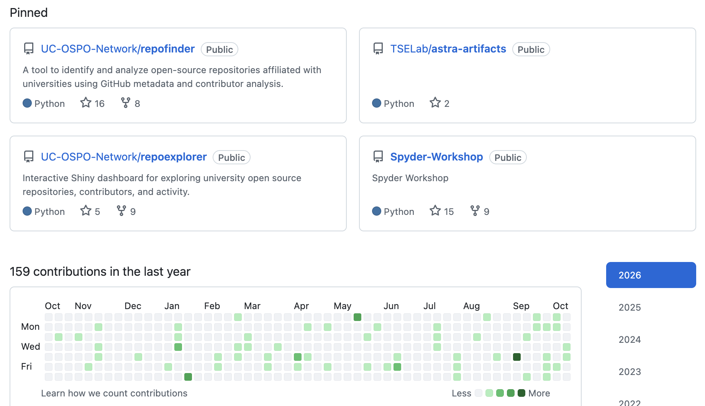

## Data Science Education in the AI Era {.title-dark background-color="#061436"}

[Data Science in the AI Era: How AI changes the workplace]{.subtitle}

::: {.byline}
**Eric Van Dusen** 
October 2026 
[github.com/ericvd-ucb](https://github.com/ericvd-ucb)
:::

::: {.title-logos}
{.berkeley-logo fig-alt="UC Berkeley"}

{.cdss-logo fig-alt="UC Berkeley College of Computing, Data Science, and Society"}
:::

::: notes
- Audience: Data Science students, faculty, professionals
- Universidad Externado, October 2026
:::

## Data Science as a framework for teaching and learning in the AI era

::: {.statement}
A new generation of AI tools is changing how people work with data and code. Data Science curricula can help students adapt to these changes.
:::

::: {.cards}
:::: {.columns}
::: {.column}
### Transferable skills
Computational skills that carry over to new tools and APIs.
:::
::: {.column}
### Authentic practice
Experience with the workflows professionals use.
:::
::: {.column}
### Domain expertise
Interdisciplinary knowledge that guides which problems to solve.
:::
::: {.column}
### Continued learning
A foundation for teaching yourself what comes next.
:::
::::
:::
::: {.bottom-question}
Inference  Insight  Computational Thinking 
:::

::: notes
- Framing for the talk; the four cards are the four parts
- Distinguish observed trends from predictions about the AI labor market
- About 1 min
:::

## Learning a new Python package

::: {.hflow}
- Read the docs
- Supply data
- Configure
- Run
- Interpret
:::

- In Econ 148, students meet new data and ML packages every few weeks and learn to use them productively.
  - NumPy → statsmodels → scikit-learn
- AI tools expose similar Python interfaces and APIs, and the same pattern applies.
  - PyTorch, TensorFlow, the OpenAI API

::: {.bottom-question}
Moving through the Data Science major is a progression of learning new Python packages.
:::

::: {.logo-row}
{fig-alt="Jupyter"}
{fig-alt="NumPy"}
{fig-alt="pandas"}
{fig-alt="scikit-learn"}
{.logo-sm fig-alt="PyTorch"}
:::

::: notes
- The pattern is the transferable skill, not the package
- Next slide is the concrete example
:::

## One Econ 148 lecture, nine packages

::: {.chips .three}
- pandas: data frames
- matplotlib: plotting
- numpy: arrays and math
- yfinance: market data
- statsmodels: ARIMA
- xgboost: gradient boosting
- prophet: trend and seasonality
- Kronos: a financial foundation model
- OpenRouter: an LLM inference API
:::

- Each package has its own documentation and arguments, but the workflow is the same.
- Calling a foundation model or an LLM API looks much like fitting ARIMA.

[Econ 148 notebook: "Can the Model Beat the Market?"]{.caption}

::: notes
- Lecture 15 notebook: ARIMA vs XGBoost vs Prophet vs Kronos, then ask an LLM to critique the backtest
- Kronos is pretrained on candlestick data; loads from Hugging Face in a few lines
- Optional live demo, have fallback screenshots
:::

## From the Data Science lifecycle to MLOps

:::: {.columns}
::: {.column width="50%"}
[Data Science lifecycle]{.flow-label}

::: {.flow .flow-grey}
- Collect data
- Prepare
- Model
- Evaluate
- Iterate
:::
:::
::: {.column width="50%"}
[AI Harness Engineering]{.flow-label}

::: {.flow .flow-navy}
- Parse data into a tokenized format
- Data pipelines
- Inference pipelines
- Parse and manage outputs
- Update and Iterate
:::
:::
::::

::: {.bottom-question}
Data Science curricula can build on this foundation by introducing MLOps and AI operations.
:::

::: notes
- The lifecycle is already central to Data Science courses
- Im learning about building AI harness and MLOps pipelines, and the same principles apply
:::

## Debugging and evaluating AI workflows

Currently debugging is a big part of using AI tool.  Problems can come from any part of a workflow, not only the code.

::: {.chips .three}
- Data quality
- Joins
- Transformations
- Code
- Models
- Interpretation
:::

- Things break and you have to problem solve to fix them.  
- Check assumptions, inspect intermediate results, question unexpected outputs.
- AI-generated code and model outputs still require validation.
- Test driven development and reproducibility.  

::: notes
- Example: a join that silently drops rows, then a model that looks fine
- These habits matter more as AI writes more of the code
- Who is going to be able to debug and validate AI systems?  People who understand the data and the models.
:::

## Data engineering as a foundation for ML/AI

::: {.build-wrap}
::: {.build-stack}
::: {.layer .l6}
**AI applications:** RAG, embeddings, enterprise tools
:::
::: {.layer .l5}
Models
:::
::: {.layer .l4}
Analysis
:::
::: {.layer .l3}
Pipelines and transformations
:::
::: {.layer .l2}
SQL and databases
:::
::: {.layer .l1}
Organizational data
:::
:::
::: {.build-side}
Many Data Science graduates begin professional work with SQL, databases and data transformations.

AI may automate some query writing. Understanding an organization's data and keeping pipelines reliable remain essential.
:::
:::

::: notes
- Both ML and AI depend on reliable data infrastructure
- RAG and embeddings are data preparation problems first
:::

## Metacognition 1: Notebook-based instruction

:::: {.columns}
::: {.column width="48%"}
- Code, narrative, data, visualizations and results in one environment
- Students start with real questions and working examples, then modify them
- Programming and math concepts arrive in the context of a substantive problem
:::
::: {.column width="52%"}
{.shot fig-alt="Computational and Inferential Thinking, the open Data 8 textbook"}

[inferentialthinking.com]{.caption}
:::
::::

::: {.bottom-question}
Is notebook-based instruction a change in how we teach computing?
:::

::: notes
- Data 8 as the example
- The same approach extends to experimenting with AI models and inference
:::

## Metacognition 2: Why are we learning this way?

::: {.statement}
Jupyter, NumPy, Python APIs and cloud environments are not only classroom conveniences.
:::

::: {.statement-2}
They are part of the scientific and professional computing ecosystem.
:::

- Students learn to explore, troubleshoot, adapt and build with the same tools professionals use.
- Students can adapt to new technologies as they emerge.
- *Faculty need to keep evolving the curriculum to reflect changes in the professional ecosystem.*

::: notes
- Ask the room: why are we learning this way?
- Connect the choice of tools to long-term adaptability
:::

## Metacognition 3: Teaching through the open-source stack

::: {.statement}
Data Science courses teach with open-source tools, so students learn the same stack used in research and industry.
:::

::: {.cards}
:::: {.columns}
::: {.column}
### Origins
IPython and Jupyter grew out of scientific computing and open research communities.
:::
::: {.column}
### An open stack
Python, NumPy, pandas and Jupyter are open-source projects maintained by communities.
:::
::: {.column}
### Reproducibility
Notebooks make methods and outputs shareable. Reproducing them also depends on environments, dependencies, data access and execution order.
:::
::::
:::

::: notes
- Teaching open source is part of the curriculum, not only a choice of tools
- Fernando Pérez, IPython at Berkeley roots
- Transparent workflows matter more as AI systems spread
:::

## Fernando Pérez and IPython {.profile-slide}

:::: {.columns}
::: {.column width="64%"}
- From Medellín; studied at Universidad de Antioquia
- PhD in Physics at CU Boulder, where he took time from his dissertation to write IPython
- Professor of Statistics at UC Berkeley
- Now leading work to bring Jupyter to new fields
  - GIS, biology and health
:::
::: {.column width="36%"}
{.shot fig-alt="Fernando Pérez's GitHub profile"}

[github.com/fperez]{.caption}
:::
::::

::: notes
- Colombian roots: Medellín, Universidad de Antioquia
- IPython (2001) led to Project Jupyter; co-founder of Jupyter and 2i2c
- Berkeley Institute for Data Science, Schmidt Center for Data Science and Environment
:::

## Everyone can participate in open source

::: {.statement}
Open-source projects depend on participants, and many contributions do not require writing code.
:::

::: {.chips .three}
- Code
- Documentation
- Bug reports
- Tutorials
- Answering questions
- Supporting new users
:::

::: {.bottom-question}
I have learned a lot by participating in Project Jupyter. My outreach to the education community has made me feel like a member of the Jupyter community.

The current journey of learning about LLM and AI and there are incredible communities around open source tools. It makes it exciting to learn. 
:::

::: notes
- Good first issues, documentation fixes
- Personal note: Project Jupyter, outreach to educators
- Lead into the student example
:::

## Juanita Gómez: a path through open source {.profile-slide}

:::: {.columns}
::: {.column width="62%"}
- Undergraduate in pure mathematics at Universidad Javeriana, Colombia
- Core developer for the Spyder IDE at Quansight
- Community manager for the Scientific Python Project
- PhD candidate in Computer Science at UC Santa Cruz
- Open Source Sustainability Program Manager at NVIDIA
:::
::: {.column width="38%"}
{.shot fig-alt="Juanita Gómez's GitHub profile"}

[github.com/juanis2112]{.caption}
:::
::::

::: notes
- Spyder at Quansight is where she started contributing to open source
- Also SciPy Conference organizing committee, PyCon US security track chair, open-source security research with the UCSC Open Source Program Office
- Visible contributions and community work complement coursework
- Confirm permission to share before presenting
:::

## GitHub Open Source and AI {.title-logo fig-alt="GitHub logo"}

- GitHub hosts much of the world's collaborative software development and open-source work.
- GitHub Copilot and related tools bring AI assistance into the places where software is built.
- AI is being added to established collaborative workflows rather than replacing them.
- Econ 148 course materials and assignments use GitHub.

::: notes
- Attended GitHub Universe last year (confirm year), saw this transition firsthand
:::

## GitHub by the numbers {.title-logo fig-alt="GitHub logo"} {.ghnum-slide}

:::::: {.columns}
::::: {.column width="60%"}
::: {.cards .stats}
:::: {.columns}
::: {.column}
### 180M+
Developers on GitHub; 36M joined in 2025
:::
::: {.column}
### 395M
Public and open-source repositories, up 19% in a year
:::
::: {.column}
### 4.3M+
AI-related repositories, nearly double in under two years
:::
::: {.column}
### 50M
GitHub Copilot users, July 2026
:::
::::
:::
:::::
::::: {.column width="40%"}
::: {.photo-pair}
{fig-alt="Entrance tunnel at GitHub Universe with the Octocat at the end"}
{fig-alt="Eric Van Dusen in front of the Octocat sculpture at GitHub Universe, San Francisco"}
:::

[GitHub Universe, San Francisco]{.caption}
:::::
::::::

::: {.bottom-question}
Latin America added about 3.2 million developers in 2025, and GitHub names Colombia among its stand-out markets.
:::

[GitHub Octoverse 2025; Microsoft FY2026 Q4 earnings call, July 29, 2026]{.caption}

::: notes
- No standalone valuation: Microsoft acquired GitHub for $7.5B in 2018
- Copilot 50M counts free, student and paid users; 4.7M paid subscribers as of January 2026
- About 80% of new GitHub users try Copilot in their first week (Octoverse)
- 630M total repositories; 1.12B contributions to public repos in 2025
- Octoverse 2026 likely out at GitHub Universe in late October; update if so
:::

## Databricks: Big Data infrastructure  {.title-logo fig-alt="Databricks logo"}

::: {.hflow}
- AMPLab
- Apache Spark
- Databricks
- Enterprise AI
:::

- Databricks grew out of Berkeley's AMPLab and the Apache Spark project.
- Its early work focused on large-scale data processing and analytics.
- Enterprise AI applications create new demand for platforms that connect an organization's data to models.

::: {.bottom-question}
The Berkeley connection shows the continuity between data engineering and AI.
:::

::: notes
- Personal Berkeley connection
- Verify any company metrics and valuation dates before adding numbers
:::

## Databricks in 2026 {.title-logo fig-alt="Databricks logo"}

::: {.cards .stats}
:::: {.columns}
::: {.column}
### $190B
Valuation after a $5B round led by Coatue, August 2026
:::
::: {.column}
### $7B+
Revenue run-rate, growing more than 80% year over year
:::
::: {.column}
### 20,000+
Organizations worldwide use the platform
:::
::: {.column}
### 70%
Of the Fortune 500 are customers
:::
::::
:::

::: {.bottom-question}
The AI revolution did not make big data obsolete. It made big data infrastructure even more important.
:::

[Databricks press release, August 13, 2026]{.caption}

::: notes
- Company-reported figures; Databricks is private
- Valuation rose from $134B (February 2026) to $190B six months later
- More than 1,000 customers spend over $1M a year; more than 100 spend over $10M
- Positive adjusted free cash flow over the last 12 months, per the release
- IPO planned eventually, not now
:::

## Alpaca Python API trading {.title-logo fig-alt="Alpaca logo"}

- Alpaca built an API-first brokerage for trading.
- Python-based trading tools used to require a fairly specialized set of skills.
- AI coding assistants make it easier for more people to experiment with APIs and build applications.
- Understanding finance, data, testing and risk still matters when code is easier to generate.

::: notes
- Distinguish brokerage accounts from unique users; correlation, not causation
- Link to the Econ 148 trading backtest
:::

## Alpaca in 2026 {.title-logo fig-alt="Alpaca logo"}

::: {.cards .stats}
:::: {.columns}
::: {.column}
### $1.15B
Series D valuation, January 2026
:::
::: {.column}
### 9M+
Brokerage accounts powered through partners, not unique users
:::
::: {.column}
### ~4×
Growth in monthly active API users over six months, to July 2026
:::
::: {.column}
### 300+
Partner organizations in more than 40 countries
:::
::::
:::

::: {.bottom-question}
Alpaca attributes much of its recent API growth to AI agents connecting to its trading infrastructure.
:::

[Alpaca press releases, Business Wire, January 14 and July 16, 2026]{.caption}

::: notes
- Company-reported figures, not independently audited
- $150M Series D led by Drive Capital, Jan 2026; further $135M raise, Jul 2026
- 9M+ is accounts across partners (brokers, advisors, crypto exchanges), not people
- The 4x is monthly active API users over six months; the April release reported a different quarter-over-quarter usage figure
:::

## Interdisciplinarity!  - Built into the Data Science major

::: {.statement}
Berkeley built disciplinary expertise into the Data Science major through the Domain Emphasis requirement.
:::

::: {.chips}
- Economics
- Biology
- Physics
- Public policy
:::

- Students connect computational skills with substantive knowledge in a field.
- AI is becoming relevant to research and practice across disciplines.

::: notes
- Name a few more domain emphases if useful
- Connector courses such as Data 88E
:::

## Domain expertise as a comparative advantage

- AI assistants are making coding and prototyping more accessible.
- Identifying worthwhile problems requires knowing a field, its institutions and its constraints.
- Domain expertise helps decide which data matter and whether results are credible.

::: {.big-idea}
Students who combine domain knowledge, Data Science and AI fluency can build distinctive applications.
:::

::: notes
- Example from economics: the backtest only makes sense if you know about transaction costs and the efficient market hypothesis
:::

## Ethics and social context

::: {.statement}
Data and AI systems operate within social and institutional contexts.
:::

- Data and models reflect choices about measurement, representation and outcomes.
- Privacy, fairness, bias, accountability and social impact belong within technical education.
- AI raises further questions about transparency and concentrated technological power.
- These questions apply in industry, science, government and nonprofit work.

::: notes
- Human Contexts and Ethics in the Berkeley major
:::

## Professional responsibility in AI

Data Science graduates can help shape how AI systems are evaluated and governed.

- Evaluate performance, reliability and limitations
- Test products for bias and unequal impacts
- Promote documentation, reproducibility and auditing
- Help build professional norms and safeguards
- Recognize when to raise concerns or challenge decisions

::: {.bottom-question}
What should a professional do when they understand a system well enough to see that it may cause harm?
:::

::: notes
- Discussion question; whistleblowing as the far end of the range
- Leave time for answers
:::

## Continuing to learn throughout your career

- AI frameworks and professional tools will continue to change.
- Students already practice reading documentation, trying examples, debugging and adapting workflows.
- My recent side project learning small open-weight language models followed the same process.
- The next important package or workflow may not exist yet.

::: {.big-idea}
You have learned how to teach yourself new computational tools. Keep Learning.
:::

[ericvd@berkeley.edu · [github.com/ericvd-ucb](https://github.com/ericvd-ucb)]{.caption}

::: notes
- Return to the first slide: read the docs, supply data, configure, run, interpret
- Small models: Hugging Face, Ollama, JupyterHub
:::

## Building a GitHub portfolio {.title-logo fig-alt="GitHub logo"}

:::: {.columns}
::: {.column width="45%"}
::: {.statement}
A portfolio documents what you built and how you thought about it.
:::

- Pinned projects, each with a short description
- A record of contributions over time
- Work in other people's projects and organizations
:::
::: {.column width="55%"}
{.shot fig-alt="Pinned repositories and contribution graph on Juanita Gómez's GitHub profile"}

[github.com/juanis2112]{.caption}
:::
::::

::: {.bottom-question}
Build a GitHub portfolio and keep improving it. A well-explained project tells an employer more than code alone.
:::

::: notes
- README with question, data, method, result
- Course projects count
:::
