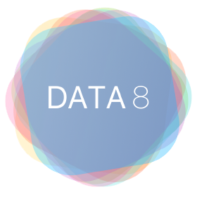
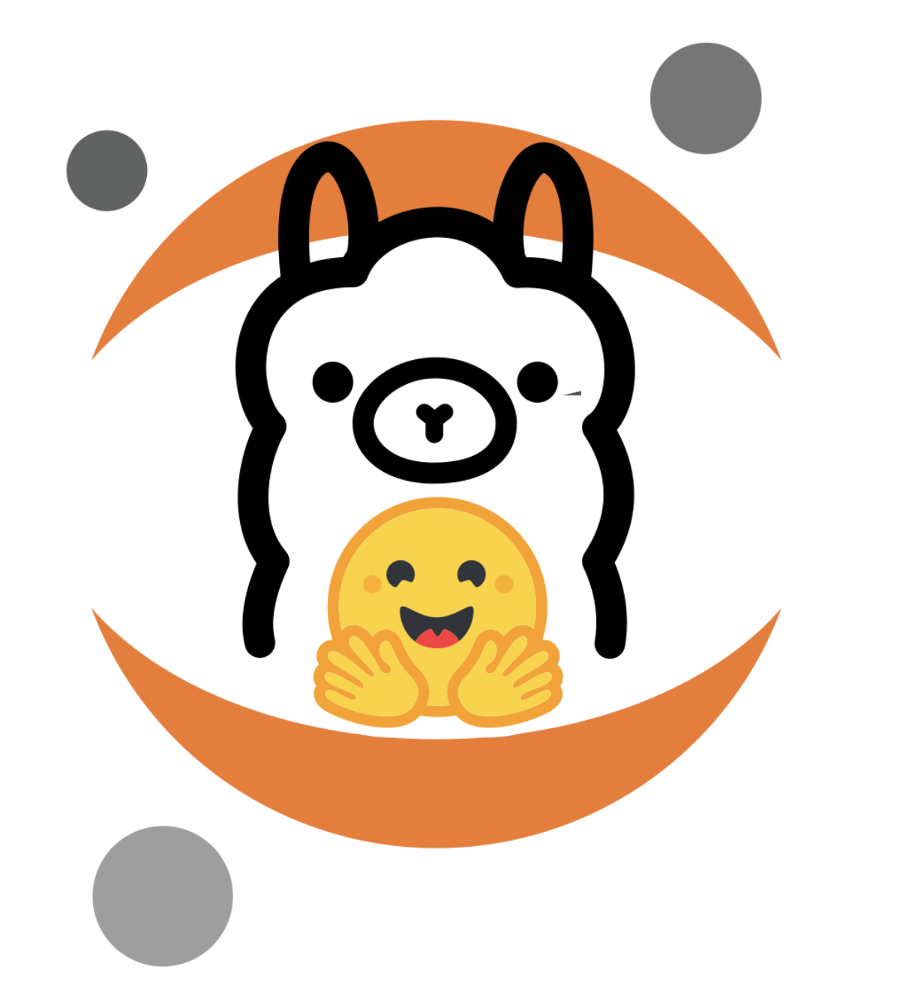
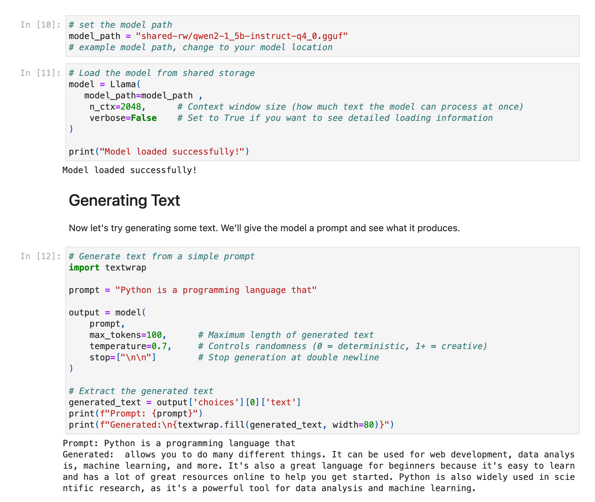
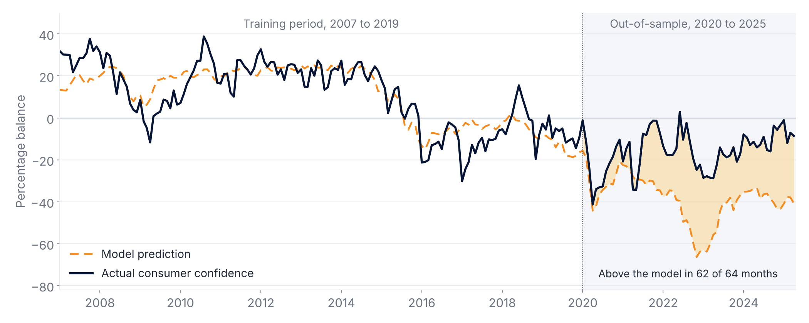
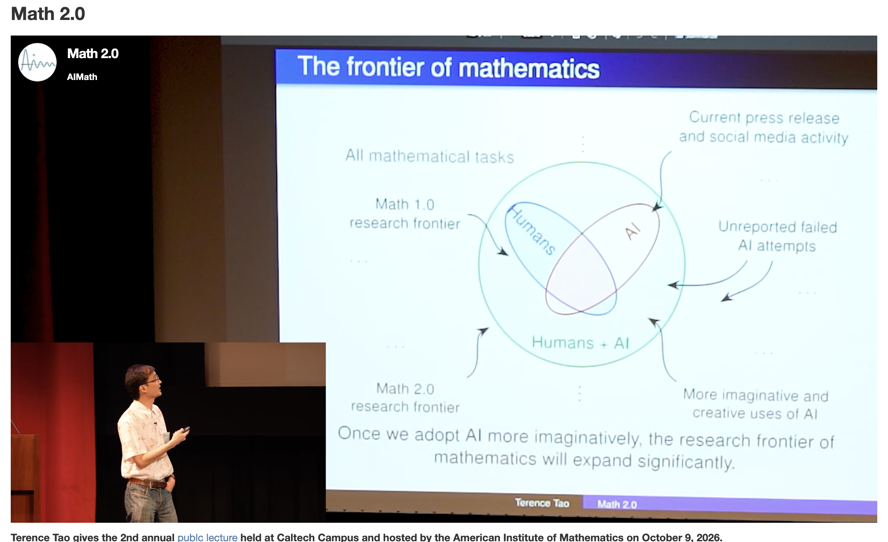

## Data Science in the AI Era {.title-dark background-color="#061436"}

[How should data science education evolve?]{.subtitle}

::: {.byline}
**Eric Van Dusen**<br>
Keynote, Universidad Externado de Colombia<br>
October 21, 2026<br>
[github.com/ericvd-ucb](https://github.com/ericvd-ucb)
:::

::: {.title-logos}
{.berkeley-logo fig-alt="UC Berkeley"}
{.cdss-logo fig-alt="UC Berkeley College of Computing, Data Science, and Society"}
:::

::: notes
- Thank Camilo and Externado
- About 60 minutes, questions at the end
:::

## Outline

::: {.cards}
:::: {.columns}
::: {.column}
### 1. Data science
What a decade of teaching data science at Berkeley has taught us.
:::
::: {.column}
### 2. AI
What changes when models can write code and analyze data.
:::
::: {.column}
### 3. Colombia
Open-source contributors and questions from Colombian data.
:::
::: {.column}
### 4. Evolving
How courses and students can grow, and why there is more to do.
:::
::::
:::

::: {.bottom-question}
If AI makes computational tools available to more people, what new questions can students investigate?
:::

::: notes
- The question at the bottom is the thread for the whole talk
:::

## The Data 8 story {.title-logo fig-alt="Data 8 logo"}

:::: {.columns}
::: {.column width="45%"}
::: {.statement}
A first course in computing and statistics, for any major, in the browser, with real data from day one.
:::

::: {.statement-2}
The largest course at UC Berkeley. Up to half of undergraduates take it, and it is the gateway to Berkeley's largest major.
:::
:::

::: {.column width="55%"}
{.shot fig-alt="Computational and Inferential Thinking, the open Data 8 textbook"}

[inferentialthinking.com]{.caption}
:::
::::

::: {.bottom-question}
Students did not have to learn all of the machinery before they could do data science.
:::

::: notes
- Changed the order in which students meet technical material
- Traditional order: programming, then statistics, then linear algebra
:::

## The notebook became the laboratory

::: {.hflow}
- Browser
- Notebook
- Data
- Experiment
:::

:::: {.columns}
::: {.column width="50%"}
- Jupyter, Python and real data
- Change the code and see what happens
- The same environment for instructors and students
:::

::: {.column width="50%"}
- Reproducible across a class
- Works for 20 students or for thousands
- Open-source tools, open curriculum and shared infrastructure
:::
::::

::: {.bottom-question}
Next, I would like to see notebooks in the mathematics foundation as well: calculus, linear algebra and discrete mathematics.
:::

::: notes
- Linear algebra notebooks: the "calculator with memory" approach
- No development environment to configure before the first experiment
- Underneath: JupyterHub run by the campus
:::

## Three lessons from a decade of scaling

::: {.cards}
:::: {.columns}
::: {.column}
### Remove friction
JupyterHub means no installs and no laptop gap. Students meet ideas before they meet configuration problems.
:::
::: {.column}
### Connect to disciplines
Connector courses such as Data 88E (Economic Models) give students the domain context that makes methods useful.
:::
::: {.column}
### Open everything
Open textbook, notebooks, autograding and deployment on GitHub. Openness is what let the curriculum travel.
:::
::::
:::

::: {.statement-2}
These lessons are how Data 8 reached community colleges in California and partners such as Universidad Externado.
:::

::: notes
- Openness as the distribution mechanism
- Cal-ICOR, Cloudbank Classroom for less-resourced campuses
- How I met Camilo
:::

## Interdisciplinarity in the Data Science major

::: {.statement}
Berkeley built disciplinary expertise into the Data Science major through the Domain Emphasis requirement.
:::

::: {.chips}
- Economics
- Biology
- Physics
- Public policy
:::

- Students connect computational skills with substantive knowledge in a field.
- AI is becoming relevant to research and practice across disciplines.

::: notes
- Name a few more domain emphases
- Connector courses such as Data 88E
:::

## A new field, with a curriculum built fresh

::: {.statement}
Data Science did not inherit a curriculum. Berkeley had to design one, with faculty from statistics, computer science and many other disciplines.
:::

::: {.cards}
:::: {.columns}
::: {.column}
### Interdisciplinary faculty
Courses designed by teams from statistics, computer science and the domains.
:::
::: {.column}
### Open materials
Textbooks, notebooks and assignments kept on GitHub, where they can be revised each term.
:::
::: {.column}
### Continual renewal
Data 8 and Data 100 are moving from pandas to Polars. Notebooks are being updated for AI tools.
:::
::::
:::

::: {.bottom-question}
A young field can keep renewing its curriculum as the tools change.
:::

::: notes
- No department had to give up an existing course sequence
- Polars migration across Data 8, Data 100, Data 88E, Econ 148
- AI-era notebook upgrade is the current example of renewal
:::

## What if we did the same thing with AI?

::: {.statement}
Put a model in the notebook, and let students investigate it the way they investigate data.
:::

::: {.chips}
- Prompt it
- Change parameters
- Examine tokens and probabilities
- Create embeddings
- Add retrieval
- Compare models
- Build evaluations
- Investigate failures
:::

::: {.big-idea}
The notebook can become a laboratory for AI.
:::

::: notes
- Same pattern as Data 8: give students the object first, then the theory
- Form hypotheses about model behavior and test them
:::

## Who owns the laboratory?

:::: {.columns}
::: {.column width="50%"}
[Commercial AI]{.flow-label}

::: {.flow .flow-grey}
- Notebook
- API
- Proprietary model
- Commercial cloud
:::

[Students learn to use a product.]{.outcome .outcome-grey}
:::

::: {.column .fragment width="50%"}
[Open-weight models on an open stack]{.flow-label}

::: {.flow .flow-navy}
- Notebook
- Open-source tooling
- Open model
- Shared or public compute
:::

[Students can inspect, modify, evaluate and build.]{.outcome .outcome-navy}
:::
::::

::: notes
- An API key is convenient, but every exercise ends at someone else's model
- Equity: not every student or campus can pay for access
:::

## Small open models as teaching tools

:::: {.columns}
::: {.column width="42%"}
A small open model is a file that students can count, inspect and test. Many experiments do not need a frontier model.

- Parameters × bits ÷ 8 = size
- Tokens and next-token probabilities
- Temperature
- The linear algebra underneath
:::

::: {.column width="58%"}
```{.python code-line-numbers="false"}
from transformers import AutoTokenizer
from transformers import AutoModelForCausalLM

name = "HuggingFaceTB/SmolLM2-135M"  # 270 MB
tok = AutoTokenizer.from_pretrained(name)
lm = AutoModelForCausalLM.from_pretrained(name)

prompt = "Bogotá is famous for its"
ids = tok(prompt, return_tensors="pt")
probs = lm(**ids).logits[0, -1].softmax(-1)
for p, i in zip(*probs.topk(5)):
    print(tok.decode(i), f"{p:.0%}")
```

{.center-logo fig-alt="Hugging Face, Ollama, and Jupyter logos combined"}
:::
::::

::: notes
- Demystification as part of AI literacy
- One to seven billion parameters is enough for most teaching purposes
:::

## Small models on a JupyterHub

:::: {.columns}
::: {.column width="58%"}
{.shot fig-alt="Jupyter notebook loading a small Qwen model from a local file and generating text"}
:::

::: {.column width="42%"}
The model is stored in a shared folder on the JupyterHub. Students load it, change parameters and observe the results, with no setup.

- Administrator: sets up the environment
- Instructor: sets up the curriculum
- Student: explores

[[Cloudbank Classroom](https://www.cloudbank.org/training/access-cloudbank-classroom)]{.caption}
:::
::::

::: notes
- Same roles as for Data 8 on DataHub
- Cloudbank Classroom provides hubs for campuses without their own
:::

## Small models in the browser {.lite-slide}

:::: {.columns}
::: {.column width="34%" .lite-qr}
{fig-alt="QR code linking to the Small Models in the Browser site"}

**Try it on your laptop**

[ericvd-ucb.github.io/small-models-lite](https://ericvd-ucb.github.io/small-models-lite/)
:::

::: {.column width="66%"}
{.lite-logo fig-alt="JupyterLite"}

A JupyterLite site where small language models run in the student's browser through WebLLM, with no server, API key or installation.

- Talking to models and generation settings
- Tokens, chunking and embeddings
- Memory with SQLite and embedding search
- Inside an open-weight model package

[Requires Chrome or Edge with WebGPU.]{.caption .left}
:::
::::

::: notes
- No live demo; invite students to scan and try it after the talk
- First model download takes a few minutes, then it is cached
- Thanks to Jeremy Tuloup and the JupyterLite community
:::

## Why small open models?

::: {.cards}
:::: {.columns}
::: {.column}
### Environment and carbon
Data centres used about 485 TWh last year, roughly as much as Germany, and the IEA expects that to double by 2030. Laptops and campus servers use little power and need little cooling.
:::
::: {.column}
### Sovereignty
Models on institutional servers keep control of the tools, the data and privacy. Open-weight models trail the frontier by about four months.
:::
::: {.column}
### Less corporate control over education
Courses built on open models do not depend on a company's pricing, terms of service or product decisions. Subsidized AI for rent cannot last indefinitely.
:::
::::
:::

::: {.bottom-question}
"Educators can train students not only how to use AI models, but also how to determine when local models are preferable to cloud-based systems."
:::

[Buhler, Pérez & Boettiger, "[Scientists should shift away from AI data centres](https://www.nature.com/articles/d41586-026-02451-2)," *Nature* 656, 296–298 (2026)]{.caption}

::: notes
- Nature Comment by Cassidy Buhler, Fernando Pérez and Carl Boettiger (Schmidt Center for Data Science & Environment, Berkeley)
- Fernando Pérez appears again in a few slides
- Corporate openness can change with the next release; curriculum should be able to swap models
:::

## Fernando Pérez and IPython {.profile-slide}

:::: {.columns}
::: {.column width="64%"}
- From Medellín; studied at Universidad de Antioquia
- PhD in Physics at CU Boulder, where he took time from his dissertation to write IPython
- Professor of Statistics at UC Berkeley
- Now leading work to bring Jupyter to new fields
  - GIS, biology and health
:::

::: {.column width="36%"}
{.shot fig-alt="Fernando Pérez's GitHub profile"}

[github.com/fperez]{.caption}
:::
::::

::: notes
- IPython (2001) led to Project Jupyter; co-founder of Jupyter and 2i2c
- A Colombian contribution used by millions of students and researchers
:::

## Juanita Gómez: a path through open source {.profile-slide}

:::: {.columns}
::: {.column width="62%"}
- Undergraduate in pure mathematics at Universidad Javeriana, Colombia
- Core developer for the Spyder IDE at Quansight
- Community manager for the Scientific Python Project
- PhD candidate in Computer Science at UC Santa Cruz
- Open Source Sustainability Program Manager at NVIDIA
:::

::: {.column width="38%"}
{.shot fig-alt="Juanita Gómez's GitHub profile"}

[github.com/juanis2112]{.caption}
:::
::::

::: notes
- Started contributing through Spyder at Quansight
- SciPy Conference organizing committee, PyCon US security track chair
- Confirm permission to share
:::

## Everyone can participate in open source

::: {.statement}
Open-source projects depend on participants, and many contributions do not require writing code.
:::

::: {.chips .three}
- Code
- Documentation
- Bug reports
- Tutorials
- Answering questions
- Supporting new users
:::

::: {.bottom-question}
My own outreach to educators has made me a member of the Jupyter community. The open-source communities around small models have made learning about AI much easier.
:::

::: notes
- Good first issues, documentation fixes
- Personal note on Project Jupyter
:::

## A Colombian question: the vibecession {.chart-slide}

{fig-alt="Colombian consumer confidence and a macroeconomic model's prediction, 2007 to 2025. After 2020, actual confidence is above the model's prediction in 62 of 64 months."}

[Consumer confidence (Fedesarrollo, via OECD and FRED) and an OLS prediction from inflation, unemployment, the interbank rate, pesos per dollar and the stock index, trained on 2007 to 2019.]{.caption}

::: {.bottom-question}
After 2020, Colombians were more optimistic than this model predicts. Without the exchange rate in the model, the gap reverses sign.
:::

::: notes
- Notebook 02 in Colombia-26-NB
- R² 0.72 in training; actual above model in 62 of 64 months, by 22.7 points on average
- The peso drives the result: training range 1,700 to 3,400 COP/USD, test reaches 4,900
- National strike, Apr to May 2021: only months below the model
- Point: the model identifies a relationship; interpreting it requires knowledge of Colombia
:::

## Shared tools, local questions {.lite-slide}

:::: {.columns}
::: {.column width="62%"}
Eight notebooks prepared for students in Colombia, each running in Google Colab or JupyterLite:

- US and Colombian vibecessions
- Colombia's economy by president
- Bollinger bands
- ML trading: ARIMA, XGBoost and Kronos
- Fantasy Premier League team selection
- SQL with Formula 1 data
:::

::: {.column width="38%" .lite-qr}
{fig-alt="QR code linking to the Colombia-26-NB notebook repository"}

[github.com/ericvd-ucb/Colombia-26-NB](https://github.com/ericvd-ucb/Colombia-26-NB)
:::
::::

::: {.bottom-question}
Open materials allow instructors to adapt a curriculum to local data rather than start from scratch.
:::

::: notes
- Global tools, Colombian datasets and policy questions
- Possible local topics: inequality, urban development, environment, public health
:::

## Terence Tao: the frontier keeps expanding

:::: {.columns}
::: {.column width="46%"}
{.shot fig-alt="Terence Tao, Math 2.0, Caltech, October 2026"}

[Terence Tao, "[Math 2.0](https://teorth.github.io/tao-web/slides/math-2-0-caltech-2026.pdf)," AIM Public Lecture, Caltech, October 2026. [Video](https://aimath.org/videos/terry-tao-pl/)]{.caption}
:::

::: {.column width="54%"}
::: {.statement-2}
"We are now entering an era of proof abundance in mathematics."

"The future frontiers of mathematics will always continue to expand."
:::

The same holds for data science:

- Instructors can build richer labs and explorations
- Students can take on more ambitious projects
- More questions become feasible, in more fields
:::
::::

::: {.big-idea}
AI does not leave less data science to do. It leaves more.
:::

::: notes
- Math 1.0 assumed proofs were scarce; AI is making them abundant, and the frontier moves outward
- Tao also stresses keeping human understanding at the center
- What was a semester project can now be a week's lab; the vibecession notebooks are an example
:::

## Expanding what students learn

::: {.cards}
:::: {.columns}
::: {.column}
### SQL course
Add data engineering: pipelines, transformations and data quality.
:::
::: {.column}
### Machine learning course
Add MLOps: pipelines, deployment, evaluation and monitoring.
:::
::: {.column}
### Labs
Instructors can build richer explorations with real data.
:::
::: {.column}
### Projects
Students can build larger projects in the same semester.
:::
::::
:::

::: {.statement-2}
AI tools reduce the time needed for some technical steps. That time can go to topics we could not previously fit into a course.
:::

::: notes
- The next two slides are worked examples: SQL to data engineering, ML to MLOps
:::

## More projects, more active learning

::: {.statement}
As AI tools take over some routine steps, courses can shift time from passive learning to projects and interactive work.
:::

:::: {.columns}
::: {.column width="50%"}
[Less time on]{.flow-label}

- Lectures students only watch
- Code copied from worked examples
- Problem sets with one right answer
:::

::: {.column width="50%"}
[More time on]{.flow-label}

- Projects with real data and open questions
- Notebooks students modify and extend
- Explaining, presenting and reviewing work
:::
::::

::: {.bottom-question}
How should we assess learning when students work alongside AI tools?
:::

::: notes
- Data 8 already does this at scale: students run and change code from week one
- Projects are where domain knowledge and judgment show
- Inspire conference ideas: ask students to explain code, interview after homework, mastery-based assessment (credit speakers)
:::

## Data engineering as a foundation for ML and AI

::: {.build-wrap}
::: {.build-stack}
::: {.layer .l6}
**AI applications:** RAG, embeddings, enterprise tools
:::
::: {.layer .l5}
Models
:::
::: {.layer .l4}
Analysis
:::
::: {.layer .l3}
Pipelines and transformations
:::
::: {.layer .l2}
SQL and databases
:::
::: {.layer .l1}
Organizational data
:::
:::

::: {.build-side}
Many Data Science graduates begin professional work with SQL, databases and data transformations.

AI may automate some query writing. Understanding an organization's data and keeping pipelines reliable remain essential.
:::
:::

::: notes
- Both ML and AI depend on reliable data infrastructure
- RAG and embeddings are data preparation problems first
- FPL notebooks in Databricks Free Edition as an example
:::

## From the Data Science lifecycle to MLOps

:::: {.columns}
::: {.column width="50%"}
[Data Science lifecycle]{.flow-label}

::: {.flow .flow-grey}
- Collect data
- Prepare
- Model
- Evaluate
- Iterate
:::
:::

::: {.column width="50%"}
[AI harness engineering]{.flow-label}

::: {.flow .flow-navy}
- Parse data into a tokenized format
- Data pipelines
- Inference pipelines
- Parse and manage outputs
- Update and iterate
:::
:::
::::

::: {.bottom-question}
Data Science curricula can build on this foundation by introducing MLOps and AI operations.
:::

::: notes
- The lifecycle is already central to Data Science courses
- I am learning to build AI harnesses and MLOps pipelines; the same principles apply
:::

## Students need to see the whole stack

:::: {.columns}
::: {.column width="52%"}
::: {.contrast}
A student can understand gradient descent but have no idea how an AI application works.
:::

::: {.contrast}
A student can now build an AI application without understanding gradient descent.
:::

Both are educational problems.
:::

::: {.column width="48%"}
- Data engineering
- APIs
- Containers and reproducible environments
- Cloud, GPUs and inference
- MLOps and LLMOps
- Evaluation and monitoring
:::
::::

::: {.bottom-question}
How much engineering should a Data Science curriculum teach, alongside mathematics and statistics?
:::

::: notes
- Not arguing that we stop teaching mathematics
- Where does the data come from, where is the model, where does inference happen?
:::

## Fundamentals and applications

::: {.statement}
There is a tension between learning fundamentals and learning applications. Data Science courses have shown that students can learn both at once.
:::

:::: {.columns}
::: {.column width="50%"}
[Fundamentals]{.flow-label}

- Inference and uncertainty
- Probability and statistics
- Linear algebra
- Computational thinking
:::

::: {.column width="50%"}
[Real tools]{.flow-label}

- Jupyter and Python
- pandas, Polars and scikit-learn
- SQL and databases
- Git and GitHub
:::
::::

::: {.bottom-question}
In Data 8, the tools are introduced in service of the concepts, using real data from the first week.
:::

::: notes
- The same approach can work for AI: the model as the object of study, with the fundamentals underneath
:::

## Learning a new Python package

::: {.hflow}
- Read the docs
- Supply data
- Configure
- Run
- Interpret
:::

- In Econ 148, students meet new data and ML packages every few weeks and learn to use them productively.
  - NumPy → statsmodels → scikit-learn
- AI tools expose similar Python interfaces and APIs, and the same pattern applies.
  - One Econ 148 lecture uses nine packages, from statsmodels ARIMA to the Kronos foundation model and an LLM API.

::: {.logo-row}
{fig-alt="Jupyter"}
{fig-alt="NumPy"}
{fig-alt="pandas"}
{fig-alt="scikit-learn"}
{.logo-sm fig-alt="PyTorch"}
:::

::: notes
- The pattern is the transferable skill, not the package
- Econ 148 "Can the Model Beat the Market?": pandas, matplotlib, numpy, yfinance, statsmodels, xgboost, prophet, Kronos, OpenRouter
- Calling an LLM API looks much like fitting ARIMA
- Keep learning: the next important package may not exist yet
:::

## Debugging and evaluating AI workflows

Debugging is a large part of using AI tools. Problems can come from any part of a workflow, not only the code.

::: {.chips .three}
- Data quality
- Joins
- Transformations
- Code
- Models
- Interpretation
:::

- Check assumptions, inspect intermediate results and question unexpected outputs.
- AI-generated code and model outputs still require validation.
- Test-driven development and reproducibility.

::: notes
- Example: a join that silently drops rows, then a model that looks fine
- Who can debug and validate AI systems? People who understand the data and the models
:::

## Domain expertise as a comparative advantage

- AI assistants are making coding and prototyping more accessible.
- Identifying worthwhile problems requires knowing a field, its institutions and its constraints.
- Domain expertise helps decide which data matter and whether results are credible.

::: {.big-idea}
Students who combine domain knowledge, Data Science and AI fluency can build distinctive applications.
:::

::: notes
- Economics example: a backtest only makes sense if you know about transaction costs and market efficiency
- Vibecession: knowing about the 2021 strike and the peso
:::

## Professional responsibility in AI

Data and AI systems operate within social and institutional contexts. Data Science graduates can help shape how they are evaluated and governed.

- Evaluate performance, reliability and limitations
- Test products for bias and unequal impacts
- Protect privacy; promote documentation, reproducibility and auditing
- Help build professional norms and safeguards
- Recognize when to raise concerns or challenge decisions

::: {.bottom-question}
What should a professional do when they understand a system well enough to see that it may cause harm?
:::

::: notes
- Human Contexts and Ethics in the Berkeley major
- Discussion question; leave time for answers
:::

## Building a GitHub portfolio {.title-logo fig-alt="GitHub logo"}

:::: {.columns}
::: {.column width="45%"}
::: {.statement}
A portfolio documents what you built and how you thought about it.
:::

- Pinned projects, each with a short description
- A record of contributions over time
- Work in other people's projects and organizations
:::

::: {.column width="55%"}
{.shot fig-alt="Pinned repositories and contribution graph on Juanita Gómez's GitHub profile"}

[github.com/juanis2112]{.caption}
:::
::::

::: {.bottom-question}
A well-explained project tells an employer more than code alone.
:::

::: notes
- README with question, data, method, result
- Course projects count; the Colombia notebooks are a starting point
:::

## Data science in the AI era

::: {.cards}
:::: {.columns}
::: {.column}
### Learn to compute
Computational literacy belongs in every discipline.
:::
::: {.column}
### Learn to question
Statistics, inference and domain knowledge decide whether a result is credible.
:::
::: {.column}
### Learn to build
Contribute to open-source communities and work on problems that matter to you.
:::
::::
:::

::: {.statement}
Ten years ago we asked how every student could learn with data. Now we can ask how every student can look inside AI, and how much more they can do with it.
:::

[ericvd@berkeley.edu · [github.com/ericvd-ucb](https://github.com/ericvd-ucb)]{.caption}

::: notes
- Return to the opening question: what new questions can students investigate?
- Open source is a community that needs participants
- Thank Externado, Camilo; questions
:::
